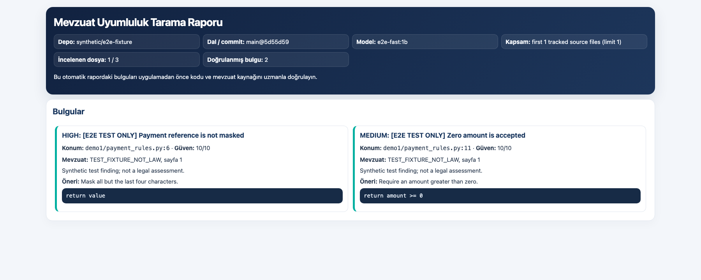
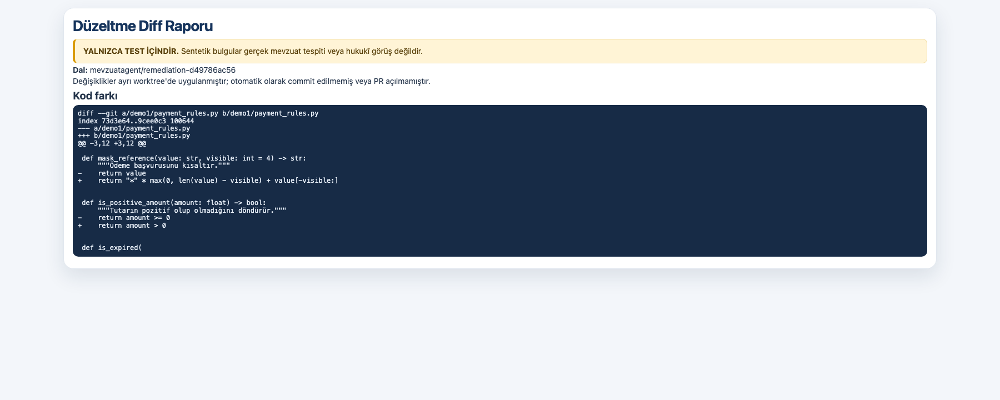

# MevzuatAgent

<p></p>

MevzuatAgent, kartlı ödeme sistemleri geliştiren yazılım depolarını kullanıcının
seçtiği mevzuat belgeleri ışığında incelemek için geliştirilen Python tabanlı
bir projedir. Ödeme başlatma/yetkilendirme, tutar ve para birimi kontrolleri,
tekrar deneme/idempotency, kart verisi maskeleme, iade ve mutabakat gibi alanlar
inceleme bağlamını oluşturur. Proje ödeme işlemi gerçekleştirmez ve canlı ödeme
altyapısına bağlanmaz; yalnızca onaylanan kod ve belge kapsamını analiz eder.
İndirme, mevzuat arama, tarama tahmini, bulgu raporlama ve kontrollü düzeltme
adımları ayrı ve kullanıcı onayına bağlıdır.


## İçindekiler

- [Proje durumu](#proje-durumu)
- [İş akışı](#iş-akışı)
- [Bileşenler](#bileşenler)
- [Sistem gereksinimleri](#sistem-gereksinimleri)
- [Kurulum](#kurulum)
- [Hızlı yerel test](#hızlı-yerel-test)
- [İlk çalıştırma](#ilk-çalıştırma)
- [Ödev rubriğiyle eşleşme](#ödev-rubriğiyle-eşleşme)
- [Ödev sunumu](#ödev-sunumu)
- [Yapılandırma dosyaları](#yapılandırma-dosyaları)
- [Belgeleri indirme ve RAG indeksi oluşturma](#belgeleri-indirme-ve-rag-indeksi-oluşturma)
- [Depo klonlama](#depo-klonlama)
- [Model havuzu ve tarama tahmini](#model-havuzu-ve-tarama-tahmini)
- [Onaylı tarama iş akışını çalıştırma](#onaylı-tarama-iş-akışını-çalıştırma)
- [Raporlar](#raporlar)
- [Remediation ve test](#remediation-ve-test)
- [Testleri çalıştırma](#testleri-çalıştırma)
- [Dizin yapısı](#dizin-yapısı)
- [Güvenlik ve gizlilik](#güvenlik-ve-gizlilik)
- [Bilinen sınırlamalar ve sonraki geliştirmeler](#bilinen-sınırlamalar-ve-sonraki-geliştirmeler)
- [Sorun giderme](#sorun-giderme)

## Proje durumu

Bu depo, Türkçe terminal menüsüyle çalışan Python araçlarını ve LangChain
tabanlı tarama zincirini içerir. Kurulumdan sonra `mevzuat-agent` komutu
mevzuat hazırlama, depo seçme, tahmin/onaylı tarama ve kontrollü remediation
adımlarını başlatır. Masaüstü/web arayüzü veya kalıcı sohbet ajanı değildir.

| İşlev | Durum |
|---|---|
| JSON yapılandırmalarını doğrulama | Uygulandı |
| Mevzuat PDF'lerini indirme | Uygulandı |
| PDF metnini orta boyutlu, örtüşen parçalara ayırma | Uygulandı |
| Yerel mevzuat araması | Uygulandı; BM25 anahtar kelime araması |
| Kullanıcı onayından sonra depo klonlama | Araçta uygulandı |
| Kurulu Ollama modellerinin hızını ölçme ve süre tahmini | Uygulandı |
| Tahmin, tarama onayı, sınırlı tarama ve raporlamayı LangChain ile bağlama | Uygulandı; Python API |
| Markdown ve HTML tarama raporu | Uygulandı |
| En önemli iki bulgu için düzeltme planı | Uygulandı |
| Açık onayla izole worktree'de verilen düzeltmeyi uygulama | Araçta uygulandı |
| Türkçe terminal menüsüyle temel adımları çalıştırma | Uygulandı |
| En önemli iki bulgu için yerel Ollama düzeltme önerisi | Uygulandı; öneri kullanıcıya gösterilir |
| İzole remediation dalında açık onayla test çalıştırma | `pytest`, `unittest`, `dotnet`, `maven`, `gradle`, `npm` için uygulandı |
| Test başarılıysa son onayla GitHub PR oluşturma | Uygulandı; `gh` ve yetkili remote gerekir |
| Düzeltmenin hukuki doğruluğunu otomatik kanıtlama | Uygulanmadı; uzman incelemesi gerekir |

Menü, kullanıcı onaylarını ayrı aşamalarda ister. Bir onay; sonraki test,
commit veya GitHub işlemlerine otomatik olarak aktarılmaz.

## İş akışı

1. `mevzuat_link.json` ve `repo_link.json` bağlantı dosyaları doğrulanır.
2. Mevzuat PDF'leri indirilir. Her sayfanın metni yaklaşık 1.200 karakterlik,
   200 karakter örtüşmeli parçalara ayrılır; kaynak dosya, sayfa ve parça
   konumu korunur.
3. RAG verisi yerel `chunks.jsonl` dosyasına yazılır ve BM25 ile aranır.
   Mevcut uygulama embedding tabanlı vektör veritabanı kullanmaz.
4. Depolar ancak açık kullanıcı onayından sonra yerel çalışma alanına klonlanır.
5. Seçilen depo ve dosya kapsamı için kurulu Ollama modelleri ölçülür; model
   başına tahmini token miktarı ve süre listelenir. En hızlı model önerilir.
   Yerel kullanım için fiyat bilgisi verilmediğinden parasal maliyet üretilmez.
6. Kullanıcı tahmin edilen modeller arasından birini seçip onaylamadan tarama
   başlamaz. İş akışı tarama öncesi branch ve commit değerlerinin tahminle
   aynı olduğunu kontrol eder.
7. Kod, ilgili mevzuat parçalarıyla birlikte Ollama'ya gönderilir. Kaynak satır
   kanıtı ve mevzuat sayfa/kaynak atfı doğrulanmayan bulgular elenir.
8. Tarama JSON'u, Markdown ve HTML raporları üretilir. Bulgu varsa en yüksek
   öncelikli iki bulgu için öneri planı oluşturulur.
9. Kod değiştirme, test çalıştırma ve PR oluşturma ayrı işlemlerdir. Bunlar
   tarama onayıyla otomatik olarak onaylanmış sayılmaz.

## Bileşenler

| Dosya | Görevi |
|---|---|
| `src/mevzuat_agent/tools/validate_config.py` | Bağlantı JSON dosyalarını doğrular. |
| `src/mevzuat_agent/tools/mevzuat_config.py` | Mevzuat bağlantılarını okur ve kaydeder. |
| `src/mevzuat_agent/tools/download_mevzuat.py` | Mevzuat belgelerini indirir. |
| `src/mevzuat_agent/tools/build_mevzuat_rag.py` | PDF metnini parçalar ve BM25 indeksini kurar. |
| `src/mevzuat_agent/tools/clone_repositories.py` | Açık onayla depoları klonlar; depo kodunu çalıştırmaz. |
| `src/mevzuat_agent/tools/estimate_scan_cost.py` | Kurulu modelleri ölçer ve tarama süresini tahmin eder. |
| `src/mevzuat_agent/tools/scan_repository.py` | Sınırlı dosya taraması yapar, kanıtı doğrulanmış bulguları kaydeder. |
| `src/mevzuat_agent/tools/generate_scan_report.py` | JSON sonuçtan Markdown ve HTML rapor üretir. |
| `src/mevzuat_agent/tools/prepare_remediation_plan.py` | En fazla iki bulgu için onay öncesi plan hazırlar. |
| `src/mevzuat_agent/tools/propose_remediation.py` | İlgili dosyalar için Ollama'dan sınırlı değişiklik önerisi alır. |
| `src/mevzuat_agent/tools/apply_remediation.py` | Onaylı içerikleri izole Git worktree ve dalına uygular, diff raporlar. |
| `src/mevzuat_agent/tools/validate_remediation.py` | Açık onayla pytest/unittest/dotnet/maven/gradle/npm testlerini çalıştırır ve raporlar. |
| `src/mevzuat_agent/tools/create_github_pr.py` | Testi geçen değişiklikleri son onayla GitHub'a gönderip PR açar. |
| `src/mevzuat_agent/workflows/scan.py` | Tahmin, onay, tarama ve raporlamayı LangChain `Runnable` zincirinde bağlar. |
| `src/mevzuat_agent/console.py` | Türkçe etkileşimli menüyle belge, klonlama, tarama ve remediation adımlarını sunar. |
| `src/mevzuat_agent/prompts/system_prompt_tr.md` | Ajanın Türkçe kapsam ve onay kurallarını saklar. |

## Sistem gereksinimleri

- macOS (kurulum dosyası macOS içindir; diğer sistemlerde Python adımları
  elle uygulanabilir).
- Python 3.10 veya üzeri. Python 3.12 önerilir; kurulum dosyası makinedeki
  uyumlu `python3` sürümünü kullanır.
- Git.
- Ollama ve tarama için en az bir yerel model. Başlangıç modeli
  `llama3.2:1b`'dir.
- Mevzuat belgelerini ilk kez indirirken internet bağlantısı.
- Modellerin indirilmesi ve çalıştırılması için yeterli disk alanı ve bellek.

PyCharm bir Python yorumlayıcısı sağlar/kurar, fakat Ollama'nın yerini almaz.
Ollama'yı [ollama.com/download](https://ollama.com/download) adresinden kurun
veya Homebrew kullanıyorsanız `brew install ollama` çalıştırın. Ollama yerel
servisi varsayılan olarak `http://localhost:11434` adresinde beklenir.

## Kurulum

### Kolay kurulum — macOS

Proje klasöründeki **`Kurulum.command`** dosyasına çift tıklayın. macOS
güvenlik uyarısı verirse dosyanın proje kaynağından geldiğini doğrulayıp
Terminal'den çalıştırın:

```bash
cd "/proje/klasorunuz/Final-Proje_MevzuatAgent"
chmod +x Kurulum.command
./Kurulum.command
```

Komut dosyası `install.sh` kurulum aracını başlatır. Kurulum:

1. macOS, Python ve Git gereksinimlerini kontrol eder.
2. Proje içinde `.venv` sanal ortamını oluşturur.
3. Python paketlerini `pyproject.toml` manifestinden yükler.
4. Gerekli çalışma klasörlerini oluşturur ve JSON yapılandırmalarını doğrular.
5. Ollama/LLM, mevzuat indirme ve repo klonlama adımlarını ayrı ayrı sorar.
   Depolar ancak bu kurulumda açıkça onaylanırsa klonlanır.

Kurulum adımları tekrar çalıştırılabilir. Mevcut `.venv` korunur; indirilen
belgelerin veya depoların üzerine yazılmaz. Kurulum dosyası Ollama'yı
onaysız kurmaz, model indirmez veya repo klonlamaz.

### Terminal'den kurulum

```bash
git clone https://github.com/mehmetdenizersoy-code/MevzuatAgent.git
cd MevzuatAgent
./install.sh
```

Kurulum dosyasının seçenekleri:

```bash
./install.sh --help
./install.sh --skip-model       # Ollama model indirme sorusunu atla
./install.sh --skip-ollama      # Ollama kurulum ve model indirme sorularını atla
./install.sh --skip-data        # Mevzuat indirme/RAG hazırlama sorusunu atla
./install.sh --skip-clone       # repo klonlama sorusunu atla
```

Kurulum sırasında seçilen adımlar dışında işlem yapılmaz. Ollama mevcut değilse
Python paketi kurulumu tamamlanır; Ollama kurulumu için resmi indirme adresi
gösterilir. Bu durumda kod taraması kullanılamaz.

### PyCharm ile açma

1. PyCharm'da **Open** ile proje klasörünü açın.
2. **Settings → Project → Python Interpreter** menüsünden proje içindeki
   `.venv/bin/python` yorumlayıcısını seçin.
3. Kurulum dosyasını çalıştırmadıysanız PyCharm Terminal'inde `./install.sh`
   çalıştırın.
4. Ollama'nın çalıştığını Terminal'de `ollama list` komutuyla kontrol edin.
5. Testleri PyCharm test penceresinden veya `.venv/bin/python -m pytest -q`
   komutuyla çalıştırın.

### Hızlı yerel test

İlk kez kuruyorsanız önce depoyu klonlayın:

```bash
git clone https://github.com/mehmetdenizersoy-code/MevzuatAgent.git ~/PycharmProjects/Final-Proje_MevzuatAgent
```

İlk denemeyi sentetik `demo1`/`demo2` depolarıyla yapın; gerçek ödeme verisi
içeren depo kullanmayın. macOS Terminal veya PyCharm Terminal'de:

```bash
cd ~/PycharmProjects/Final-Proje_MevzuatAgent
git pull origin main
./install.sh --skip-model --skip-data --skip-clone
ollama pull gemma3:4b
ollama list
ollama run gemma3:4b "Sadece {} döndür."
.venv/bin/python -m pytest -q
.venv/bin/mevzuat-agent
```

Mevcut klonda yeniden çalıştırırken ilk `git clone` komutunu atlayın. Proje
klasörünüz farklı konumdaysa `cd` ve klonlama hedef yolunu değiştirin. Ollama
yüklü değilse [resmi kurulumdan](https://ollama.com/download) yükleyip
uygulamasını başlatın.

Modelin kısa deneme yanıtı vermesi, tarama çıktısının geçerli veya hukuken
doğru olacağını garanti etmez. Bu projede `llama3.2:1b` ile yapılan son gerçek
tarama denemesi geçersiz JSON üretti. Bu yüzden tarama adımında model listesinden
`gemma3:4b`'yi özellikle seçin; model yine hata verirse remediation'a geçmeyin.
Tarama sadece kanıtı doğrulanmış bulgular üretirse sonraki adıma izin verir.

Uygulama basit bir sohbet olarak açılır. Mevzuat kapsamını listedeki numara,
dosya adı veya `*` (tümü) ile sohbette seçin; ör. `1` ya da `1,2`. Ardından
proje hakkında doğal dille soru sorabilir veya `devam` yazarak pipeline'ın
önerdiği adımı başlatabilirsiniz. `yardım` komutları, `çıkış` uygulamayı
kapatır. Sohbet yanıtları sistem promptuna ve güncel pipeline durumuna göre
yerel Ollama modeliyle üretilir.

Pipeline aşamasını doğrudan sohbet isteğiyle de başlatabilirsiniz: `RAG
hazırla`, `depoları klonla`, `tarama yap`, `bulguları düzelt`. Her aşamadaki
indirme, klonlama, tarama, dosya değiştirme ve PR onayları ayrıca alınır.

`tarama yap` isteğinde depo listesinde `[SENTETİK TEST]` olarak işaretlenen
`data/test_repositories/demo1` veya `demo2` seçilirse beş önceden tanımlı bulgu
ile JSON, Markdown, HTML ve düzeltme planı oluşturulur. Bu deterministik demo
Ollama çağırmaz; rapor gerçek mevzuat tespiti değildir. Normal `data/repositories`
altındaki bir `demo1`/`demo2` taraması bulgusuz veya hatalı sonuçlanırsa uygulama
ayrı bir sentetik örnek rapor üretmeyi teklif eder. Kabul edilirse bu rapor
gerçek tarama veya remediation girdisi olarak kullanılmaz.
Örnek çıktı: [Markdown raporu](docs/examples/sentetik_demo1_tarama.md) |
[HTML raporu](docs/examples/sentetik_demo1_tarama.html).

Gerçek taramada tahmin ekranında taramayı onaylayın ve model sorusuna
`gemma3:4b` yazın. Model hatası veya sıfır doğrulanmış bulgu varsa gerçek
remediation başlamaz. Remediation diff'ini inceleyin ve yalnızca onayladığınız
değişikliği uygulayın; testleri ayrıca onaylayın. İlk denemede PR açma sorusuna
`hayır` deyin: bu adım gerçek GitHub commit/push işlemi yapar.

Remediation'ı daha sonra sürdürmek için `m` → `4` seçebilirsiniz. Uygulama son
tarama raporundaki depo kökünü ve tarama JSON yolunu otomatik bulur; bu yolları
elle yazmanız gerekmez. Son taramadaki bulgular için geçerli bir depo yolu
bulunamazsa yeniden klonlayıp tarayın.

Raporlar `data/reports/scans/` ve `data/reports/remediation/` altında oluşur.
Kurulum, tarama ve remediation adımlarının örnek E2E çıktıları
[burada](docs/examples/e2e_dogrulama_ozeti.md) bulunur; E2E çıktıları
deterministik/mock testtir, gerçek model veya gerçek mevzuat tespiti değildir.

## İlk çalıştırma

Sanal ortamı etkinleştirin:

```bash
source .venv/bin/activate
```

Türkçe sohbet arayüzünü başlatma:

```bash
mevzuat-agent
# eşdeğeri:
python -m mevzuat_agent
```

Sohbette mevzuat kapsamını seçtikten sonra doğal dille proje hakkında
konuşabilir ve `devam` yazarak önerilen pipeline aşamasını çalıştırabilirsiniz.
Tarama sonunda doğrulanmış bulgu varsa uygulama aynı depo ve tarama raporuyla
remediation'a geçmek için ayrıca onay ister. Gerçek tarama bulgusuz kalırsa
remediation durdurulur; `demo1`/`demo2` için yalnızca ayrı, açıkça sentetik
olarak işaretlenmiş bir örnek rapor seçeneği sunulur.

Remediation seçeneği, tarama JSON dosyasından en öncelikli iki bulguyu seçer;
Ollama önerisinin diff'ini gösterir. Kod değişikliği, test çalıştırma ve
GitHub PR için birbirinden ayrı onaylar ister. PR aşaması gerçek commit ve
push yapar; bunu yalnızca doğru Git deposunu seçtiğinizden emin olduktan sonra
onaylayın.

## Ödev rubriğiyle eşleşme

Bootcamp kapanış projesi beş eşit ağırlıklı ölçütle değerlendirilir. Aşağıdaki
eşleme, uygulamanın gösterdiği kanıtları ve sınırlarını birlikte açıklar.

| Ölçüt (%20) | Projedeki karşılığı ve kanıt |
|---|---|
| Problem tanımı ve gerçek dünya uygunluğu | Kartlı ödeme yazılımlarında maskeleme, tutar ve idempotency gibi gerçekçi kontroller için mevzuat destekli ön inceleme. Çıktı uzman kararı veya uygunluk sertifikası değildir. |
| Agentic mimari ve eğitim yaklaşımları | Yerel Ollama, BM25 tabanlı mevzuat RAG'i, Python araçları ve çok adımlı LangChain `Runnable` akışı. Depo, tarama, düzeltme, test ve PR farklı araç/izin adımlarıdır; tek bir LLM çağrısı yerine denetlenebilir orkestrasyon gerekir. Kalıcı hafıza, otonom planlayıcı ve çoklu agent yoktur. |
| İşlevsellik ve çıktı kalitesi | Kurulum, tarama ve rapor akışları ile 56 otomatik test gösterilir. Canlı model denemesi bir dosyada doğrulanmış bulgu üretmedi; pozitif bulgular ve remediation kanıtları sentetik E2E fixture'larına aittir. |
| Kod kalitesi ve teknik uygulama | Modüler Python araçları, ayrı iş akışı ve testler; yerel Ollama kullanımı bulut LLM API anahtarı gerektirmez. |
| Dokümantasyon ve teslim | README'de proje amacı, teknoloji, kurulum ve çalıştırma adımları; sunumda terminal ve rapor ekran görüntüleri bulunur. |

## Ödev sunumu

28 slaytlık Türkçe sunum; problem tanımını, mimariyi, kurulum ve kullanım
adımlarını, terminal çıktıları ile tarama/remediation rapor görsellerini ve
rubrik eşlemesini içerir. Canlı Gemma taramasında bir dosya incelenmiş,
doğrulanmış bulgu üretilmemiştir; sentetik bulgular, remediation testi ve PR
provası ayrı test E2E'sidir. Sentetik kod farkı hukukî tespit değildir; PR yanıtı
yerel bare remote ve mock `gh` ile doğrulanmış, gerçek GitHub PR'ı açılmamıştır.

- [MevzuatAgent_Odev_Sunumu_TR.pptx](docs/MevzuatAgent_Odev_Sunumu_TR.pptx)
- Kaynak üretici: `scripts/create_presentation.py`
- Terminal görselleri: `docs/assets/e2e_terminal/`
- Görselleri üretmek için: `.venv/bin/python scripts/create_terminal_evidence.py`
- HTML rapor görselleri: `docs/assets/e2e_reports/`
- Rapor görsellerini üretmek için: `.venv/bin/python scripts/create_report_previews.py`
- Sunumu üretmek için: `.venv/bin/python scripts/create_presentation.py`
- [Uçtan uca tarama raporu](docs/examples/e2e_tarama_raporu.md)

**Ekran görüntüleri (sentetik E2E örnekleri):**





Adım adım terminal kanıtları [`docs/assets/e2e_terminal/`](docs/assets/e2e_terminal/)
dizinindedir. Bu ekran görüntüleri sentetik test verisini gösterir; canlı model
bulgusu veya gerçek mevzuat ihlali değildir.
- [Remediation kod farkı](docs/examples/e2e_remediation_raporu.md)
- [Test ve PR provasının doğrulama özeti](docs/examples/e2e_dogrulama_ozeti.md)

Sunum, konuşmada verilen dokuz gereksinime dayanır. Ekli PDF dosyası bu çalışma
ortamında yalnızca genel bir PDF simgesi olarak göründüğünden içindeki rubrik
doğrulanamamıştır; PDF şartlarıyla birebir eşleştirme yapıldığı iddia edilmez.

## Yapılandırma dosyaları

Proje kökündeki yapılandırmalar:

### `mevzuat_link.json`

İndirilecek belgelerin HTTP(S) bağlantılarını içerir:

```json
{
  "links": [
    "https://www.mevzuat.gov.tr/MevzuatMetin/1.5.5464.pdf"
  ]
}
```

### `repo_link.json`

Kullanıcı onayıyla klonlanabilecek HTTPS/SSH Git depo bağlantılarını içerir:

```json
{
  "repos": [
    "https://github.com/ornek/uygulama.git"
  ]
}
```

Bağlantıları doğrulayın:

```bash
.venv/bin/python - <<'PY'
from mevzuat_agent.tools.validate_config import validate_config

result = validate_config(".")
for error in result.errors:
    print(error)
if result.is_valid:
    print("Yapılandırma geçerli.")
PY
```

## Belgeleri indirme ve RAG indeksi oluşturma

Bu adımı kurulumda seçebilir veya elle başlatabilirsiniz:

```bash
.venv/bin/python - <<'PY'
from mevzuat_agent.tools.download_mevzuat import download_mevzuat
from mevzuat_agent.tools.build_mevzuat_rag import build_mevzuat_rag

download = download_mevzuat("data/legislation/downloads")
for document in download.documents:
    print(f"İndirildi: {document.path} ({document.size_bytes} bayt)")
for error in download.errors:
    print(f"İndirme hatası: {error}")
if download.errors and not download.documents:
    raise SystemExit("Mevzuat belgeleri indirilemedi.")

rag = build_mevzuat_rag(
    "data/legislation/downloads",
    "data/legislation/rag",
    chunk_size=1200,
    chunk_overlap=200,
)
print(f"Parça sayısı: {len(rag.chunks)}")
print(f"İndeks: {rag.index_path}")
for error in rag.errors:
    print(f"RAG uyarısı: {error}")
if not rag.chunks:
    raise SystemExit("Aranabilir mevzuat metni oluşturulamadı.")
PY
```

Üretilen önemli dosyalar:

- İndirilen kaynaklar: `data/legislation/downloads/`
- BM25 parçaları: `data/legislation/rag/chunks.jsonl`
- İndeks özeti: `data/legislation/rag/manifest.json`

Bu RAG çözümü yerel metin eşleşmesi yapar; vektör embedding veya semantik
vektör veritabanı değildir. PDF taranmış görüntülerden oluşuyorsa metin
çıkarımı boş kalabilir; OCR şu anda uygulanmamıştır. Mevzuat PDF'lerini
yeniden indirmek için var olan hedef dosyaları elle silmeden önce yedek alın;
indirme aracı mevcut dosyanın üzerine yazmaz.

## Depo klonlama

Kurulum dosyası `repo_link.json` içindeki depoları klonlamak için ayrıca onay
ister. Elle kullanmak için:

```bash
.venv/bin/python - <<'PY'
from mevzuat_agent.tools.clone_repositories import clone_repositories

result = clone_repositories(
    "data/repositories",
    config_path="repo_link.json",
    user_approved=True,  # Bu değeri yalnızca depoları klonlamayı onayladıysanız verin.
)
for checkout in result.checkouts:
    print(f"Klonlandı: {checkout.path}")
for error in result.errors:
    print(f"Klonlama hatası: {error}")
PY
```

`user_approved=True` açık onay anlamına gelir. Araç repo kodunu çalıştırmaz.
Daha önce aynı adla yerel depo varsa üzerine yazmaz; hata olarak bildirir.

## Model havuzu ve tarama tahmini

Ollama yerel servisinin çalıştığını ve model bulunduğunu kontrol edin:

```bash
ollama list
ollama pull llama3.2:1b
```

`ollama pull` yalnızca model indirmeyi siz istediğinizde çalıştırın. Model
havuzu tahmin aracı kurulu Ollama modellerini kısa isteklerle ölçer; tüm
modeller ve en hızlı öneri için:

```python
from mevzuat_agent.tools.estimate_scan_cost import estimate_scan_cost_for_model_pool

estimate = estimate_scan_cost_for_model_pool(
    ["data/repositories/demo1"],
    rag_index_path="data/legislation/rag/chunks.jsonl",
    max_files=5,
)
for model in estimate.models:
    print(
        f"{model.model}: {model.tokens_per_second:.2f} token/sn, "
        f"tahmini {model.estimated_seconds} sn"
    )
print("Önerilen model:", estimate.recommended_model)
```

Tahmini süre benchmark ve yaklaşık token sayımına dayanır; donanım, modelin
ilk yüklenme süresi, bağlam uzunluğu ve Ollama ayarlarına göre değişir. Yerel
LLM kullanımı için parasal birim fiyat verilmediğinden parasal bedel
hesaplanmaz. `max_files` ile belirlenen tahmin kapsamı, tarama kapsamıyla aynı
olmalıdır.

## Onaylı tarama iş akışını çalıştırma

Tarama zinciri model tahminini ve kullanıcı onayını zorunlu kılar. Callback
model listesini kullanıcıya gösterir; `None` döndürmek taramayı reddeder,
ölçülen modellerden birinin adını döndürmek onay verir:

```python
from mevzuat_agent.workflows.scan import run_scan_workflow

def tarama_onayi(istek):
    print("Dosya sınırı:", istek.max_files)
    for model in istek.estimate.models:
        print(
            f"{model.model}: {model.tokens_per_second:.2f} token/sn; "
            f"yaklaşık {model.estimated_seconds} sn"
        )
    print("Önerilen:", istek.recommended_model)
    secim = input("Model adını yazarak taramayı onaylayın; vazgeçmek için Enter: ")
    return secim.strip() or None

sonuc = run_scan_workflow(
    ["data/repositories/demo1"],
    max_files=5,
    rag_index_path="data/legislation/rag/chunks.jsonl",
    output_dir="data/reports/scans",
    approval_callback=tarama_onayi,
)
print("Durum:", sonuc.status)
for depo in sonuc.repositories:
    print("Tarama JSON:", depo.scan.output_path)
    print("Markdown:", depo.markdown_report)
    print("HTML:", depo.html_report)
    if depo.remediation_plan:
        print("Düzeltme planı:", depo.remediation_plan)
```

Örneği `ornek_tarama.py` gibi bir Python dosyasına kaydedip proje sanal
ortamında çalıştırabilirsiniz. Callback yalnızca model seçimini ve tarama
onayını temsil eder. Düzeltme uygulama, test çalıştırma veya PR oluşturma
onayı vermez. İş akışı mevcut, yerel Git depolarını ve önceden hazırlanmış
RAG indeksini bekler.

## Raporlar

Tarama JSON çıktısı her depo için `data/reports/scans/` altında saklanır.
Yanında aynı temel ada sahip Markdown ve HTML dosyaları oluşturulur. Bulgu
bulunursa ayrıca `_remediation_plan.md` üretilir.

Raporlarda depo/commit, model, kapsam, tarih, incelenen dosya sayısı, bulgular,
kod kanıtı, mevzuat kaynağı ve sınırlamalar yer alır. Bulgu çıkmaması
uyumluluğun kanıtlandığı anlamına gelmez. HTML raporu kullanıcı/kod kaynaklı
değerleri HTML olarak kaçışlayarak yazar.

Canlı yerel model çalıştırmasının [JSON](docs/examples/gercek_tarama_raporu.json),
[Markdown](docs/examples/gercek_tarama_raporu.md) ve
[HTML](docs/examples/gercek_tarama_raporu.html) çıktıları da eklenmiştir. Rapor,
`data/repositories/demo1` deposunun `203506d` commit'inde 59 kaynak dosyasından
ilk ikisini `qwen3:4b` ile tarar; tam depo incelemesi değildir. Gerçek model
çıktısı uzman tarafından doğrulanmamıştır: yorum satırına dayanan, güven puanı
1/10 olan muhtemel bir yanlış pozitif kritik bulgu içerir ve diğer dosyadaki
bir bulgu kanıt doğrulamasından geçmemiştir. Bu örnek doğrulanmış mevzuat ihlali
olarak yorumlanmamalı; model sınırlamalarını da gösterir.

Sunum ve dokümantasyonda rapor biçimini göstermek için sentetik örnekler:

- [Örnek HTML tarama raporu](docs/examples/ornek_tarama_raporu.html) —
  kartlı ödeme kodu için iki temsili bulgu; `TEST_FIXTURE_NOT_LAW` gerçek mevzuat
  atfı olmadığını belirtir.
- [Örnek HTML remediation raporu](docs/examples/ornek_remediation_raporu.html) —
  izole düzeltme dalına ait temsili diff görünümü.
- [Uçtan uca doğrulama özeti](docs/examples/e2e_dogrulama_ozeti.md) —
  RAG, tahmin, tarama, remediation, test ve yerel PR provasının sonuçları.
- [Uçtan uca tarama raporu](docs/examples/e2e_tarama_raporu.html),
  [remediation diff raporu](docs/examples/e2e_remediation_raporu.html) ve
  [test raporu](docs/examples/e2e_test_raporu.html).

Örnekler yalnız rapor biçimini gösterir; gerçek tarama, hukuki görüş, test
başarısı veya PR sonucu değildir. Ödeme alanındaki maskeleme, idempotency,
tutar/para birimi ve mutabakat başlıkları da tek başına mevzuat bulgusu sayılmaz;
ilgili mevzuat metni ile kod kanıtı uzman tarafından doğrulanmalıdır.

E2E raporları deterministik test kanıtıdır: tarama LLM yanıtı mock'tur,
bulgular sentetiktir, Git push yalnızca geçici yerel bare remote'a yapılmıştır
ve GitHub PR çağrısı mock'lanmıştır. Gerçek Ollama model kalitesini veya
hukuki uygunluğu doğrulamaz. Ayrı gerçek `llama3.2:1b` tarama denemesi eksik
JSON ürettiği için dosya taraması tamamlanmadı; bu durumda uygulama remediation
aşamasına geçmedi.

## Remediation ve test

`prepare_remediation_plan` yalnızca plan oluşturur; kendi başına kod
değiştirmez. `apply_remediation` ayrı, açık `user_approved=True` onayı ister.
Yalnızca en öncelikli iki bulguyla eşleşen dosyaları değiştirir. Kaynak
deponun Git çalışma ağacının temiz olmasını, bulgu kanıtının kaynak satırda
bulunmasını ve verilen metin değişikliklerinin bu dosyalarla sınırlı olmasını
kontrol eder. Değişikliği ayrı bir `mevzuatagent/remediation-*` dalı ve
worktree içinde uygular; kaynak dalı değiştirmez. Otomatik commit veya PR
oluşturmaz.

`validate_remediation` test kodunu çalıştırdığı için ayrıca açık onay ister.
Sabit komutlarla `pytest`, `unittest`, `dotnet test`, `mvn test`, `gradle test`
ve `npm test` araçlarını destekler; proje manifestine uygun aracı seçer.
Remediation dalı dışında çalışmayı reddeder ve zaman aşımı uygular. Test
kodunun güvenilir olduğundan emin olun. Test sonucu Markdown ve HTML olarak
raporlanır; başarısızlık veya zaman aşımı başarılı gibi gösterilmez.

Test başarılıysa ve kullanıcı son kez açıkça onaylarsa `create_github_pr`
yalnızca belirtilen değişiklik dosyalarını commit eder, remediation dalını
`origin`'e gönderir ve GitHub CLI ile PR oluşturur. GitHub CLI (`gh`) kurulu,
kimliği doğrulanmış ve remote yazma yetkisi verilmiş olmalıdır. Bu aşama
GitHub'da gerçek bir değişiklik oluşturur.

## Testleri çalıştırma

```bash
.venv/bin/python -m pytest -q
```

Testler için Ollama servisi veya gerçek GitHub bağlantısı gerekmez. Demo
depoları uygulama kaynak deposuna eklenmez; `data/` yerel ve yoksayılan çalışma
verisidir. İsteğe bağlı sentetik demolar, herkese açık
[mevzuatagent-test-fixtures](https://github.com/mehmetdenizersoy-code/mevzuatagent-test-fixtures)
deposundadır. Bu depodaki `demo1` ve `demo2` yalnızca test içindir; toplam on
bulgu gerçek mevzuat tespiti veya hukukî görüş değildir.

## Dizin yapısı

```text
.
├── Kurulum.command                 # macOS çift tıklama başlatıcısı
├── install.sh                      # Python ortamı ve bağımlılık kurulum aracı
├── mevzuat_link.json               # Mevzuat kaynak bağlantıları
├── repo_link.json                  # Kullanıcı onayıyla klonlanacak depolar
├── pyproject.toml                  # Python bağımlılıkları ve proje ayarları
├── src/mevzuat_agent/
│   ├── prompts/system_prompt_tr.md # Türkçe ajan kapsam/onay promptu
│   ├── tools/                      # İndirme, RAG, tarama, rapor ve remediation
│   └── workflows/scan.py           # LangChain tarama iş akışı
├── tests/                          # Otomatik testler
└── data/
    ├── legislation/                # İndirilen PDF ve RAG indeksi
    ├── repositories/               # Onayla klonlanan çalışma depoları
    ├── reports/                    # Tarama ve remediation raporları
    └── test_repositories/          # Sentetik test depoları
```

## Güvenlik ve gizlilik

- Kod tarama için kaynak kod ve ilgili mevzuat parçaları yerel Ollama
  servisine gönderilir; bulut LLM servisine geçiş yapılandırılmamıştır.
- Uygulama gerçek kart sahibi verisini otomatik maskelediğini garanti etmez.
  Üretim PAN/CVV/PIN, kimlik bilgisi veya sır içeren depolarda taramayı
  başlatmayın; mümkünse sentetik ya da hassas veriden arındırılmış test deposu
  kullanın.
- GitHub'dan depo klonlamak ağ bağlantısı kullanır ve açık onay ister.
- İndirilen PDF'ler yerel diskte tutulur; bu verilerin güncelliği ve kullanım
  hakkı kullanıcı tarafından doğrulanmalıdır.
- Depo içeriği ve mevzuat metinleri analiz verisidir; içlerindeki talimatlar
  sistem talimatı kabul edilmemelidir.
- Tarama ve remediation araçları hedef depo içindeki kodu çalıştırmaz.
  Remediation test aracı kullanıcı onayıyla test komutu çalıştırır; yalnızca
  güvendiğiniz projelerde kullanın.
- Gerçek depo üzerinde remediation denemeden önce yedek alın ve temiz bir Git
  çalışma ağacıyla çalışın.
- Sentetik fixture raporları gerçek hukukî veya güvenlik bulgusu değildir.

## Bilinen sınırlamalar ve sonraki geliştirmeler

- Mevzuat araması BM25 anahtar kelime tabanlıdır; embedding/vektör araması,
  OCR ve belge sürüm takibi yoktur.
- Model taraması kısmi olabilir; küçük yerel modeller yanlış/eksik çıktı
  verebilir. Kanıt doğrulaması model hatalarını azaltır ama hukuki doğruluğu
  garanti etmez.
- LangChain zinciri ve Türkçe terminal arayüzü vardır; masaüstü/web arayüzü,
  kalıcı oturum/iş kuyruğu ve tarama sırasında devam ettirilebilir oturum yoktur.
- Ollama düzeltme önerisi geçerli bir patch garantisi vermez. Uygulama yalnızca
  en önemli iki bulgunun dosyaları ve doğrulanmış kanıt satırlarıyla eşleşen
  önerileri kabul eder; kullanıcı diff'i görüp ayrıca onaylar.
- Test koşturma aracı test raporlar; remediation düzeltmesinin doğruluğunu
  kanıtlamaz. Güvenilir, hedefli testlerin yazılması gerekir.

## Sorun giderme

### `python3` bulunamadı veya sürüm eski

Python 3.10+ kurun. macOS'ta Python.org yükleyicisini veya Homebrew'i
kullanabilirsiniz. Yeni Terminal açıp `python3 --version` ile doğrulayın.

### `ollama list` bağlanamıyor

Ollama uygulamasını başlatın, Terminal'de `ollama list` deneyin. Özel servis
adresi kullanıyorsanız Ollama araçlarının `ollama_url` parametresini
`http://localhost:11434` yerine kendi adresinizle çağırın.

### RAG indeksi bulunamadı veya boş

Önce `mevzuat_link.json` bağlantılarının erişilebilir olduğunu kontrol edin;
belgeleri indirin ve `build_mevzuat_rag` çalıştırın. `manifest.json` içindeki
hataları inceleyin. İndeks oluşturulurken kullanılabilir metin parçası
çıkmamışsa tarama başlamaz.

### Depo taraması bulunamadı

Tarama yalnızca Git tarafından izlenen kaynak dosyaları inceler. Yeni dosyaları
önce commit edin veya taramayı commit edilmiş bir test deposunda deneyin.
İncelenecek dosya sayısını `max_files` ile sınırlayın.

### Kurulum bağımlılıkları yüklenemedi

Proje kökünde `./install.sh` komutunu yeniden çalıştırın. Ağ/paket yöneticisi
hatasını çözmeden sanal ortamı silmeyin; hata mesajında belirtilen paketi ve
Python sürümünü kontrol edin.
