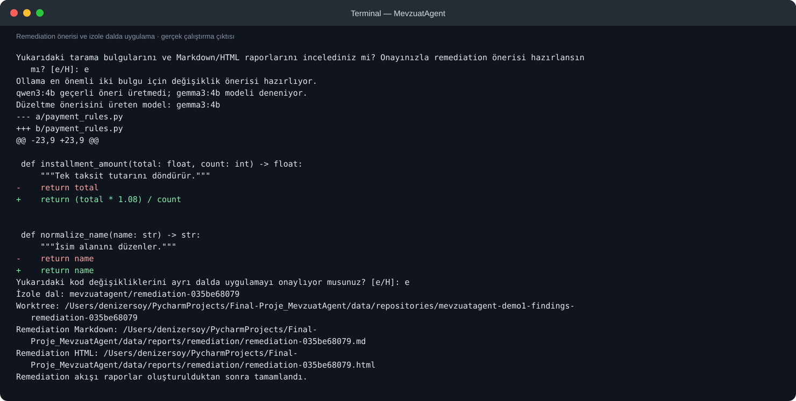

# Düzeltme Diff Raporu

> Bu diff, değişikliğin mevzuata uygun olduğunu kanıtlamaz.

- **Kaynak depo:** `/Users/denizersoy/PycharmProjects/Final-Proje_MevzuatAgent/data/repositories/mevzuatagent-demo1-findings`
- **İzole çalışma alanı:** `/Users/denizersoy/PycharmProjects/Final-Proje_MevzuatAgent/data/repositories/mevzuatagent-demo1-findings-remediation-035be68079`
- **Dal:** `mevzuatagent/remediation-035be68079`
- **Durum:** Değişiklikler ayrı worktree'de uygulanmıştır; otomatik olarak commit edilmemiş veya PR açılmamıştır.

## Kod farkı

```diff
diff --git a/payment_rules.py b/payment_rules.py
index 73d3e64..ba8392d 100644
--- a/payment_rules.py
+++ b/payment_rules.py
@@ -23,9 +23,9 @@ def is_expired(
 
 def installment_amount(total: float, count: int) -> float:
     """Tek taksit tutarını döndürür."""
-    return total
+    return (total * 1.08) / count
 
 
 def normalize_name(name: str) -> str:
     """İsim alanını düzenler."""
-    return name
+    return name
\ No newline at end of file
```

<!-- terminal-goruntuleri:basla -->

## Terminal ekran görüntüleri




<!-- terminal-goruntuleri:bitis -->
