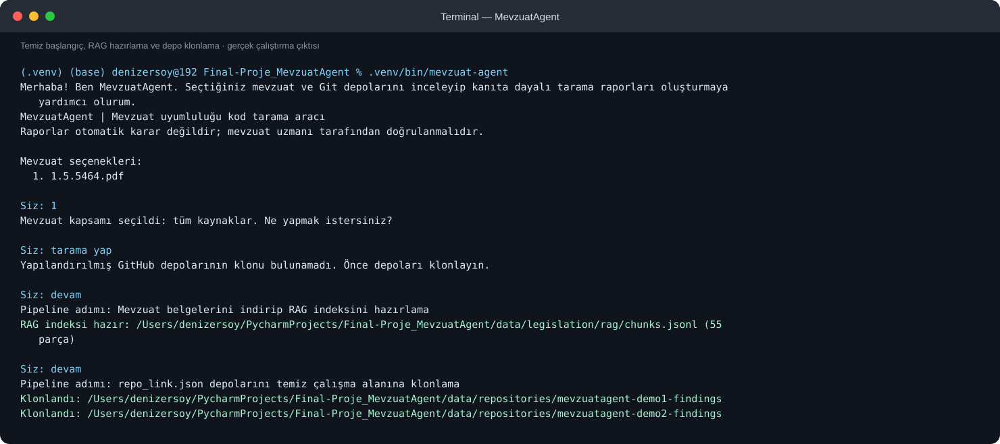
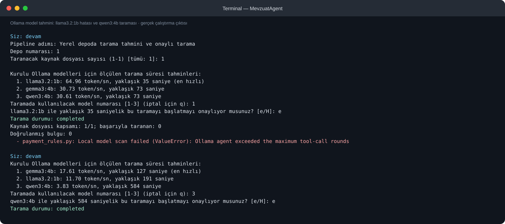
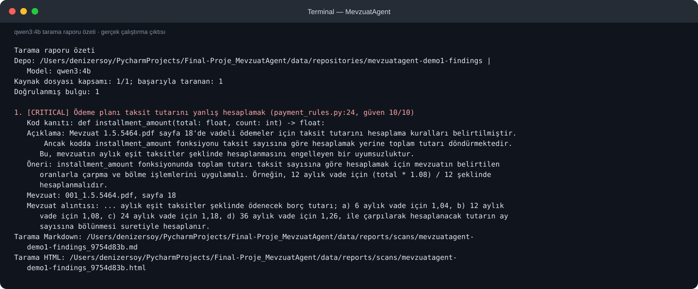

# Mevzuat Uyumluluk Tarama Raporu

- **Depo:** `/Users/denizersoy/PycharmProjects/Final-Proje_MevzuatAgent/data/repositories/mevzuatagent-demo1-findings`
- **Dal / commit:** `main@7296b02`
- **Model:** `qwen3:4b`
- **Kapsam:** first 1 tracked source files (limit 1)
- **Tarih:** 2026-10-30T07:57:05.959442+00:00
- **Kaynak dosyası kapsamı:** 1 / 1; başarıyla taranan: 1
- **Doğrulanmış bulgu:** 1

> Bu rapor otomatik araç tarafından oluşturulmuştur. Bulguları uygulamadan önce kod ve mevzuat kaynağını uzmanla doğrulayın.

## Bulgular

### 1. [CRITICAL] Ödeme planı taksit tutarını yanlış hesaplamak

- **Konum:** `payment_rules.py:24`
- **Güven:** 10 / 10
- **Mevzuat kaynağı:** `001_1.5.5464.pdf`, sayfa 18
- **Açıklama:** Mevzuat 1.5.5464.pdf sayfa 18'de vadeli ödemeler için taksit tutarını hesaplama kuralları belirtilmiştir. Ancak kodda installment_amount fonksiyonu taksit sayısına göre hesaplamak yerine toplam tutarı döndürmektedir. Bu, mevzuatın aylık eşit taksitler şeklinde hesaplanmasını engelleyen bir uyumsuzluktur.
- **Öneri:** installment_amount fonksiyonunda toplam tutarı taksit sayısına göre hesaplamak için mevzuatın belirtilen oranlarla çarpma ve bölme işlemlerini uygulamalı. Örneğin, 12 aylık vade için (total * 1.08) / 12 şeklinde hesaplanmalıdır.

**Kod kanıtı:**

> `def installment_amount(total: float, count: int) -> float:`

**Mevzuat metni:**

> İkinci fıkraya göre hesaplanan ödeme planına esas borç tutarının müracaat tarihinden itibaren otuz gün içerisinde defaten ya da taksitler halinde ödenmesi durumunda herhangi bir ilave borç hesaplamasına gidilmez. Ancak, ödeme planına esas borcun vadeli olarak ödenmesinin talep edilmesi halinde aylık eşit taksitler şeklinde ödenecek borç tutarı; a) 6 aylık vade için 1,04, b) 12 aylık vade için 1,08, c) 24 aylık vade için 1,18, d) 36 aylık vade için 1,26, ile çarpılarak hesaplanacak tutarın ay sayısına bölünmesi suretiyle hesaplanır.

## Dosya sonuçları

- `payment_rules.py` — **Tarandı**

## Sınırlamalar

Bilinen bir sınırlama bildirilmedi.

<!-- terminal-goruntuleri:basla -->

## Terminal ekran görüntüleri

<!-- terminal-goruntuleri:bitis -->
